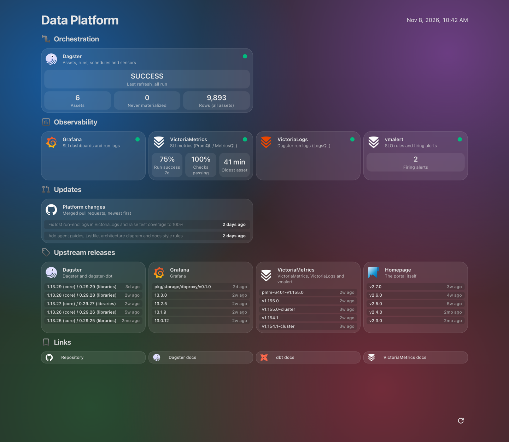
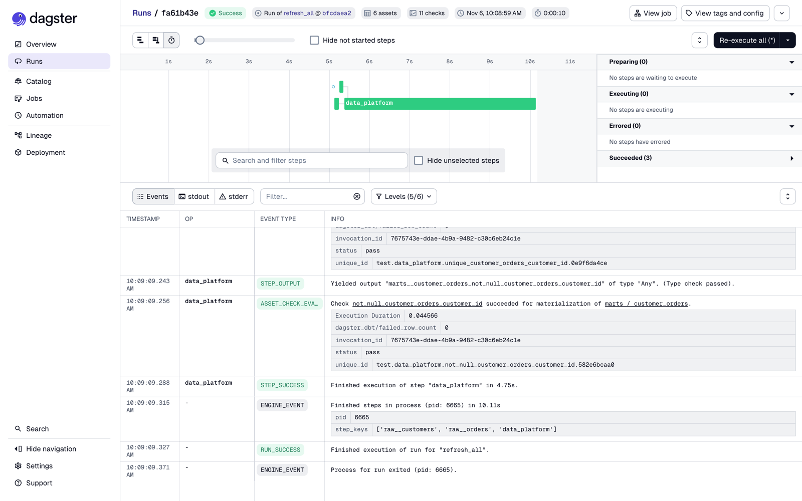
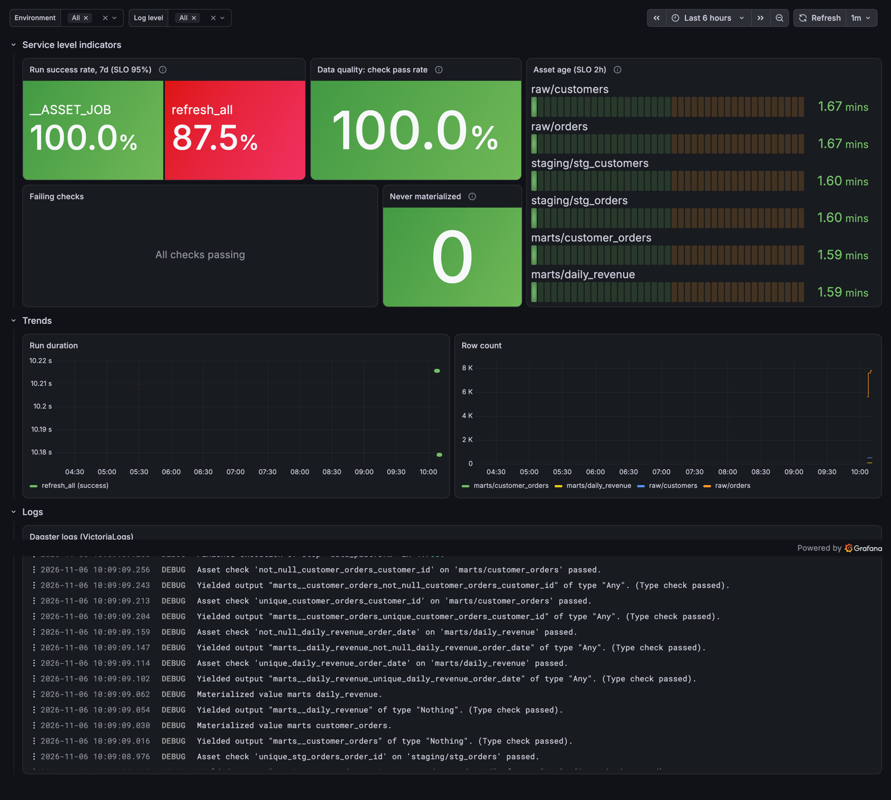
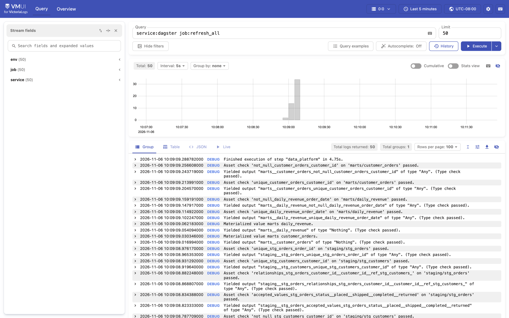
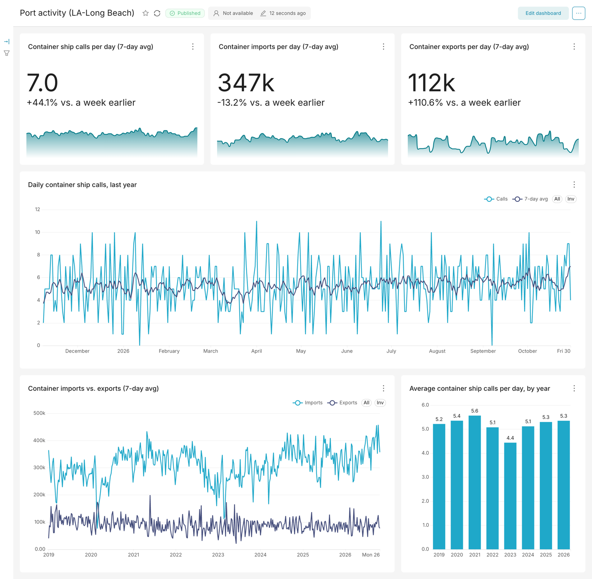

# Data platform

dbt + Dagster + DuckDB, with SLI metrics in VictoriaMetrics and logs in VictoriaLogs.


The diagram is drawn with d3 by `docs/diagram/architecture.mjs`. After editing it,
run `just diagram` (needs Node) and commit the regenerated `docs/architecture.svg`.

## Quick start

Commands are [`just`](https://github.com/casey/just) recipes (`brew install just`,
or `uv tool install rust-just`). Run `just` to list them.

```bash
just up
```

Start at the portal: one landing page linking every component, with status and live SLIs.

| Service          | URL                    |
|------------------|------------------------|
| **Portal**       | http://localhost:3002  (landing page) |
| Dagster          | http://localhost:3000  |
| Superset         | http://localhost:8088  (dashboards on the marts; log in as `admin`) |
| Grafana          | http://localhost:3001  (opens the "Data Platform SLIs" dashboard) |
| VictoriaMetrics  | http://localhost:8428/vmui |
| VictoriaLogs     | http://localhost:9428/select/vmui |
| vmalert          | http://localhost:8880  |

The `ingest_sources` job runs daily at 06:30 UTC. To run it now, open Dagster, go to
Jobs → ingest_sources → Materialize all.

For local development with hot reload, run `just dev` (`dg dev`). It runs Dagster
on your machine against the same Victoria stack and the same DuckDB file.

## Screenshots

The portal landing page: every component with its status, live SLIs, the last Dagster run, recent platform changes and upstream releases.



A Dagster run (taken with the earlier synthetic-data job `refresh_all`): every step succeeded and all dbt tests passed as asset checks.



The SLI dashboard in Grafana, after the SLI sensors exported that run.



The same run's logs in VictoriaLogs (`service:dagster job:refresh_all`).



## Portal

The portal (http://localhost:3002) runs [Homepage](https://gethomepage.dev). It's
built to be replaceable:

1. `portal/catalog.yaml` lists every component in a tool-neutral format: name, group,
   description, URL and health check URL. Homepage-only extras (live widgets) sit
   under a `homepage:` key.
2. `just portal` renders the catalog into `portal/homepage/services.yaml` and restarts
   the portal. Look and layout live in `portal/homepage/settings.yaml`, `bookmarks.yaml`,
   `widgets.yaml` (header) and `custom.css` (iOS-style glass cards; it targets
   Homepage's own class names, not Tailwind classes).
3. The Docker service is called `portal`, not `homepage`, so nothing else refers to
   the tool.

To add a component, add it to the catalog and run `just portal`. To replace Homepage,
write a renderer for the new tool that reads the same catalog, and swap the image in
`docker-compose.yml`.

The portal also shows update feeds, defined under `feeds:` in the catalog:

- **Platform changes:** the last 5 merged PRs in this repo. The repo is private, so
  this needs a fine-grained token with "Pull requests: Read-only" for this repo.
  Without it the tile shows an API error.
  - **With 1Password** (recommended): save the token in the Personal vault as an
    item named `data-platform-github-token` with the token in its `credential` field,
    then run `just up`. `.env.op` holds the reference and `op run` injects it, so the
    token is never written to disk.
  - **Without 1Password:** copy `.env.example` to `.env`, paste the token, run `just up`.
- **Upstream releases:** the latest Dagster, Grafana, VictoriaMetrics and Homepage
  releases, from their public GitHub release feeds. Compare them with the pinned
  versions in `docker-compose.yml` and `pyproject.toml` to see when to upgrade.

To host it on AWS (one EC2 spot instance, about $24/month), reached through AWS Session
Manager or at `https://<name>.<domain>` behind Google sign-in, see
`infra/README.md`.

Homepage has one page, not a page per service. For more views, put groups on tabs
(`layout.<group>.tab` in `portal/homepage/settings.yaml`) or embed a page with
Homepage's `iframe` widget.

## Superset

[Superset](https://superset.apache.org) (http://localhost:8088) is for dashboards and
SQL Lab on the dbt marts. Log in as `admin`.

It never opens `data/warehouse.duckdb`. DuckDB allows one writer process, so an open
BI query would make the next Dagster run fail. Instead:

1. After the marts update, the `bi/marts_snapshot` asset copies them into
   `data/bi.duckdb` and swaps the file in atomically. It runs as its own run
   (`serve_automation` sensor), not inside `ingest_sources`, so a snapshot problem never
   fails the pipeline.
2. Superset reads that file read-only, with writes (DML, CTAS, uploads) turned off.
   The connection is defined in `superset/assets/databases/warehouse.yaml` and
   imported on every start.

Secrets: Superset needs `SUPERSET_SECRET_KEY` and `SUPERSET_ADMIN_PASSWORD`. With
1Password, create a Login item `data-platform-superset` in the Personal vault with
a `password` field and a `secret_key` field (`openssl rand -base64 42`); `just up`
injects them (see `.env.op`). Without 1Password, set them in `.env`. If they're
missing, Superset exits with a message and everything else runs.

**Port activity (LA-Long Beach)**
(http://localhost:8088/superset/dashboard/port-activity/): IMF PortWatch data from
`marts.port_daily_activity`. Container ship calls and container import/export volumes
(7-day averages with a week-over-week change and a 90-day sparkline), daily calls over
the last year, imports vs. exports since 2019, and average calls per day by year.
Volumes are PortWatch estimates from ship tracking data.



**Trade trends (IMF PortWatch)**
(http://localhost:8088/superset/dashboard/trade-trends/): monthly views from
`marts.port_monthly_trade` and `marts.chokepoint_monthly_transits`, complete months only:

1. Imports, exports and trade balance (metric tons), each vs. a year earlier.
2. Imports and exports by ship type: container, dry bulk, general cargo, ro-ro, tanker.
3. Year-over-year change in imports, exports and ship calls, last 3 years.
4. Cargo per container ship call, a proxy for ship size and how full ships are.
5. Transits through the Panama Canal, Suez Canal, Bab el-Mandeb and Cape of Good Hope,
   which show Red Sea rerouting since late 2023.

Dashboards are config-as-code: `superset/assets/` holds the connection, datasets,
charts and dashboards, and every start imports them with `--overwrite`. To change
one, edit it in Superset, export it (Dashboards → ⋯ → Export), and replace the files
in `superset/assets/`, keeping the existing file names. Edits made only in the UI are
overwritten on the next start. New dashboards you don't export stay in Superset's
own database (the `superset-home` volume).

## Ingesting data with dlt

External data sources are loaded with [dlt](https://dlthub.com) into the warehouse,
one schema per source, and dbt builds on top of them. Current sources:

| Source | Data | Updates | Mart |
|--------|------|---------|------|
| `portwatch` | [IMF PortWatch](https://portwatch.imf.org): daily port calls and trade volumes (metric tons, by ship type) for Los Angeles-Long Beach, and transits through 28 chokepoints, estimated from ship tracking (AIS) data | Daily, about 9 days behind | `marts.port_daily_activity`, `marts.port_monthly_trade`, `marts.chokepoint_monthly_transits` |

Sources run in the `ingest_sources` job, daily at 06:30 UTC, together with the dbt
models built on them. Sources load incrementally. Assets are grouped by layer:

| Group | Assets |
|-------|--------|
| `source` | dlt loads: `<source>/<table>`, e.g. `portwatch/daily_ports` |
| `transform` | dbt staging models (`staging/*`) |
| `metrics` | dbt marts (`marts/*`) |
| `serve` | `bi/marts_snapshot`, the read-only copy for Superset (runs on its own) |

Each source is one folder under `src/data_platform/defs/sources/`, using the
`DltWarehouseLoads` component (`src/data_platform/components/dlt_warehouse.py`). Every
dlt resource becomes the asset `<source>/<table>`, which is also the key dagster-dbt
gives the dbt source table, so the lineage connects with no extra code. Row counts are
recorded, so new sources show up in the SLIs automatically.

To add a source:

1. Scaffold it: `uv run dg scaffold defs data_platform.components.DltWarehouseLoads sources/<name>`.
   This writes `defs.yaml` and a `loads.py` template.
2. In `loads.py`, define the dlt source (`rest_api_source` config, or any dlt source)
   named `<name>`. Keep `source.max_table_nesting = 0`, so each resource is one table.
   For APIs `rest_api_source` can't express (like PortWatch's ArcGIS query), write a
   small `@dlt.resource` instead; see `sources/portwatch/loads.py`.
3. Add dbt models in `dbt_project/models/staging/<name>/`: a `_<name>__sources.yml`
   with `schema: <name>`, then staging models (group `transform` automatically).
   Run `just defs-state` and `just check`.

**Inspecting pipelines:** `just dlt-dashboard` opens dlt's dashboard at
http://localhost:2718 (dependency group `dashboard`, local only; started through dlt's
open-source `run_dashboard()`, so the commercial `dlt[hub]` that `dlt dashboard` asks
for isn't needed). It shows each pipeline's last run,
load packages, schema and write dispositions, state (e.g. PortWatch's per-port
cursors) and run traces. Browsing table rows doesn't work yet: dlt 1.32 reads results
with an API DuckDB 2.0 removed; use Superset SQL Lab or `duckdb -readonly` instead.
It opens the warehouse read-only, and only while a query runs, so it can't write; a
query that happens to run while Dagster writes can still briefly block that run.

Secrets for a source go in `.env.op` (1Password) and are read by dlt from the
environment, e.g. `SOURCES__<NAME>__ACCESS_TOKEN`.

## Dagster project (dg)

The project was scaffolded with `create-dagster project` and is managed with the
`dg` CLI. `definitions.py` loads everything in `defs/` automatically, so new
definitions need no registration:

```bash
uv run dg scaffold defs dagster.asset my_asset.py      # new asset file in defs/
uv run dg check defs                                   # validate YAML and definitions
uv run dg list defs                                    # show assets, checks, jobs, sensors
uv run dg utils refresh-defs-state                     # re-parse dbt after model changes
```

dbt assets come from the `dagster_dbt.DbtProjectComponent` configured in
`defs/dbt/defs.yaml`. Each dbt model becomes an asset and each dbt test an asset check.

## Layout

```
dbt_project/                 dbt models (staging → marts) and tests
src/data_platform/
  components/                DltWarehouseLoads: reusable dlt -> DuckDB component (dg scaffold)
  definitions.py             entry point: loads everything in defs/ (scaffolded by dg)
  defs/
    dbt/defs.yaml            DbtProjectComponent: dbt models → assets, tests → checks
    sources/<name>/          one dlt source each (defs.yaml + loads.py), e.g. portwatch
    bi.py                    bi/marts_snapshot: read-only copy of the marts for Superset
    resources.py             DuckDB resource and in-process executor
    schedules.py             ingest_sources job, daily
    sli/defs.yaml            SliSensorsComponent: exports SLIs to VictoriaMetrics
packages/dagster-victoria-sli/  shared package: SliSensorsComponent and VictoriaLogsHandler
vmalert/rules.yml            SLI recording rules and SLO alerts
grafana/                     datasources and the SLI dashboard
superset/                    Superset image (DuckDB driver), config and imported connection
portal/catalog.yaml          every component, for the portal landing page (`just portal`)
portal/homepage/             Homepage config; services.yaml is generated from the catalog
docs/diagram/                d3 script that renders docs/architecture.svg (`just diagram`)
docs/screenshots/            UI screenshots used in this README
dagster_home/dagster.yaml    Dagster config for `just dev`
docker/dagster.yaml          Dagster config inside Docker
infra/                       OpenTofu: AWS EC2 host for the whole stack (infra/README.md)
```

## SLIs

| SLI | Metric | SLO (in vmalert/rules.yml) |
|-----|--------|-----|
| Pipeline success rate | `dagster_run_success{job}` (1/0 per run) | ≥ 95% over 7 days |
| Freshness | `dagster_asset_age_seconds{asset,group}` (also `..._last_materialized_timestamp_seconds`) | refreshed within 26h (daily pipeline) |
| Coverage | `dagster_asset_materialized{asset,group}` (1/0, every asset) | every asset has run |
| Data quality | `dagster_asset_check_passed{asset,check}` (dbt tests and any other checks) | all checks passing |
| Run duration | `dagster_run_duration_seconds{job,status}` | dashboard only |
| Volume | `dagster_asset_row_count{asset,group}` | dashboard only |

Assets don't push metrics themselves. They record materializations, row counts
(`dagster/row_count`) and check results in Dagster as usual. The sensors from
`SliSensorsComponent` (configured in `defs/sli/defs.yaml`) export that state every
minute and after each run. Every metric also has a `code_location` label.

The component and the VictoriaLogs handler come from the shared package
[`packages/dagster-victoria-sli`](packages/dagster-victoria-sli), a uv workspace
member of this repo. It's a separate installable package, so other code locations
can reuse it (see its README).

Asset metrics cover every asset in the code location, including ones that have
never run. The `AssetStale` alert uses the last known timestamp, so it still fires
if Dagster stops reporting, and `SliMetricsMissing` fires when reports stop arriving.

vmalert records these as `sli:*` series. Alerts appear in the vmalert UI. To get
notified, add an Alertmanager and point vmalert's `-notifier.url` at it.

Every metric and log line has an `env` label, set with `PLATFORM_ENV`.

## Querying logs

In Grafana, or at http://localhost:9428/select/vmui, using LogsQL:

```
service:dagster level:error
service:dagster run_id:"<run id>"
service:dagster job:ingest_sources | stats by (event_type) count()
```

## Notes

- DuckDB allows only one process to write at a time. Jobs use the in-process
  executor for that reason. When you open the file yourself while Dagster runs,
  open it read-only: `duckdb -readonly data/warehouse.duckdb`.
- After changing dbt models, `just dev` re-parses automatically. For Docker,
  rebuild with `just up`.
- Runs started with `dg launch` execute inside the CLI process and aren't tied to
  the code location, so the run success and duration SLIs skip them. Asset SLIs
  still update. Launch from the UI or let the schedule run them to count toward
  the run SLIs.
- `dagster dev` in one container is fine for a single machine. For production,
  run the webserver and daemon separately with Postgres storage.
